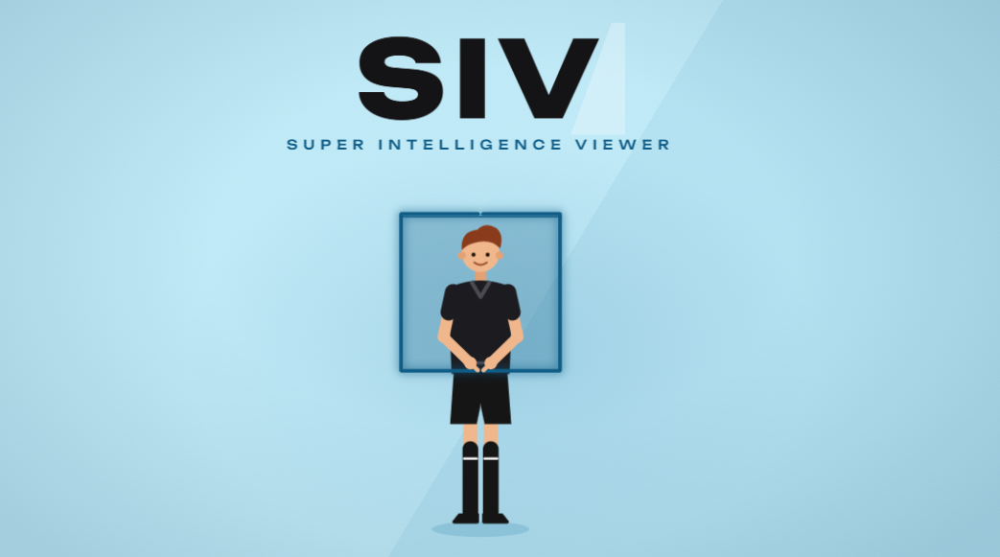
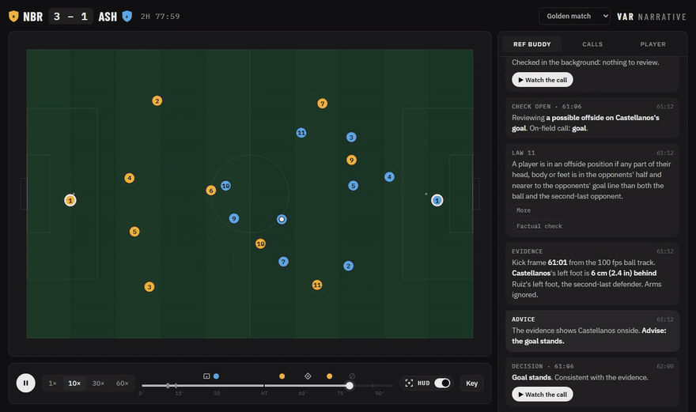
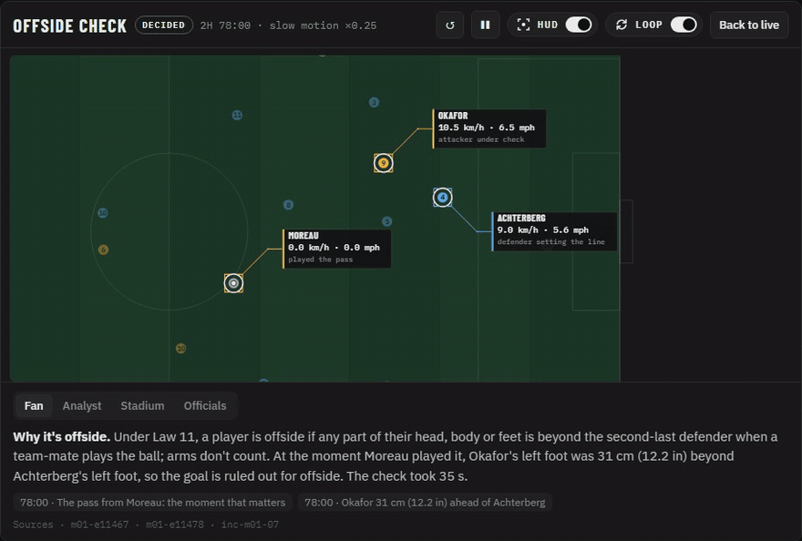
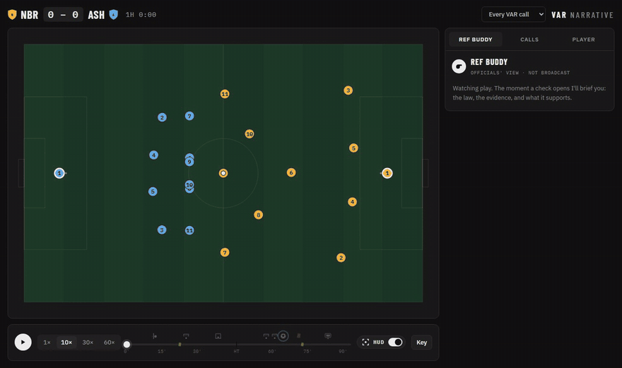
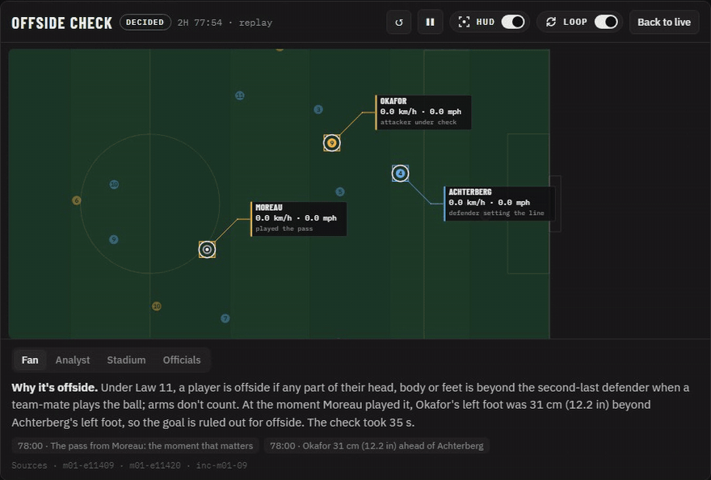
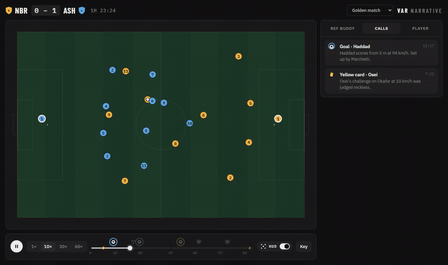
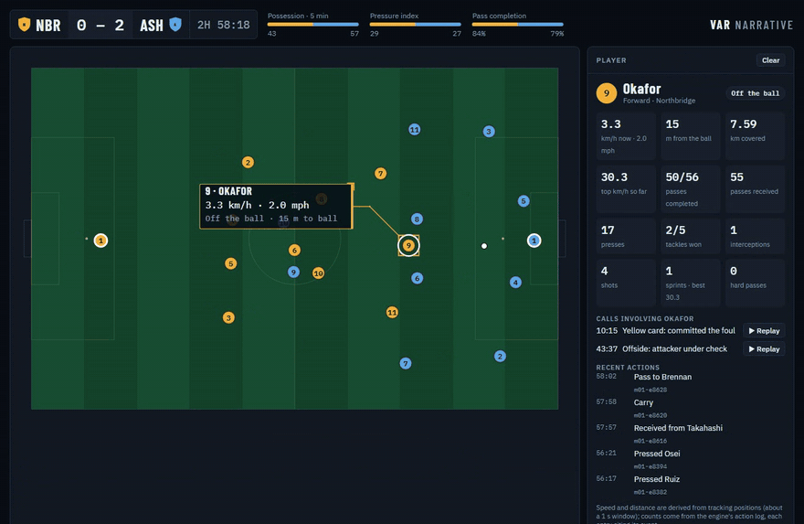

# SIV: Super Intelligence Viewer



**VAR calls are the moments fans understand least.** A goal goes in, the screen says "Check in
progress", and a minute later it is gone, with nothing anyone in the stadium or at home can follow.

SIV makes those calls understandable. While a check runs, it shows what is being checked,
under which law, and why it is taking time. The moment the officials decide, and never before, it
shows the evidence: a replay of the build-up, the line, the margin in centimetres and inches, and the
players involved, explained for casual fans, analysts, the stadium screen and the officials' own
briefing.

Two rules keep it trustworthy:

- **Every number traces to the match data.** Speeds, distances and margins are measured from
  positions, never stated, and every on-screen claim cites the events it came from.
- **Nothing about a decision airs before the decision.** No margin, measurement or verdict leaves the
  engine while a check is open. Tests enforce it.

Built for the Microsoft Premier League Hackathon (Oct 2026). All clubs, players and matches are
fictional and generated by the simulator.

## See it

**A VAR check, live.** The broadcast says only what is being checked. On the right, Ref Buddy briefs
the officials: the law, the evidence at the kick frame, and what it supports. Then the decision lands
with the lines and a replay one tap away.



**Every call explained: the rule, the evidence, the decision.** Slow motion into the moment of the
pass, then a freeze and zoom onto the line: the attacker's front foot against the defender's, arms
ignored (Law 11), measured to the centimetre from a 100 fps ball track. The fan explanation states the
rule and shows how the evidence leads to the call. Loops until you close it.



**Every VAR call that can be measured, measured.** Offside is one of six. Each is simulated, measured
from positions and the ball track, and explained with the rule and the evidence:

| Call | What is measured | Law |
|---|---|---|
| Offside | front playable part against the second-last defender | 11 |
| Ball out of play before a goal | how far the whole ball was over the goal line or touchline | 9 |
| Goal-line | whether the whole ball crossed, by how much | 10 |
| Penalty or free kick | where contact started against the edge of the area (the line counts as the area) | 12, 14 |
| Keeper off the line at a penalty | the keeper's nearest foot against the goal line at the kick | 14 |
| Denying an obvious goal-scoring opportunity | distance, direction, defenders between, control | 12 |



**Who was involved, and how fast.** A toggleable HUD follows the players in the call, with speeds
derived from tracking positions, never stated by the feed.



**A calm timeline.** Goals, VAR checks, penalties and red cards sit above the bar; cards and flags are
ticks on it. The Calls list grows as the match plays, so nothing is spoiled.



**Tap any player.** Live speed, distance to the ball, whether they are in the play, their match so
far, and every call they were part of.



<sub>Clips are recorded from the preview with `uv run python scripts/record_gifs.py`, so they always
match the code.</sub>

> Status: contracts, CI, the simulator with five kinds of VAR call, the Azure base (Foundry, Event
> Hubs), the engine, call replays, the preview, the MCP server and the grounding validator are in
> place; the agent workflow is next.
> See [docs/build-plan.md](docs/build-plan.md).

## Layout

| Path | What |
|---|---|
| `contracts/` | Pydantic models for the four JSON contracts; generates `web/src/contracts.ts` |
| `sim/` | Seeded match simulator and Event Hubs producer |
| `engine/` | Stats, offside (Law 11), decision state machine, replays |
| `mcp_server/` | Read-only MCP tools over match state |
| `agents/` | Detector, Explainer, Decision Desk, Persona, Recap, and prompts |
| `orchestrator/` | Agent Framework workflow, grounding validator, cue emitter |
| `console/` | Producer console API |
| `evals/` | Eval harness and report |
| `web/` | Fan app, producer console UI, replay player |
| `infra/` | Bicep and `azure.yaml` for `azd up` |

## Run locally

```sh
uv sync
uv run pytest
uv run python -m sim golden -o golden.jsonl   # simulate a match: golden | red_card | late_comeback
uv run python -m sim.realism                  # check every scenario looks like football
uv run python -m contracts.generate && npm --prefix web run gen:contracts
```

Watch a match in the browser (simulator + engine, no Azure needed):

```sh
uv run python -m engine.export                       # writes web/preview/data/*.json
uv run python -m http.server 8765 -d web/preview     # then open http://localhost:8765
```

The simulator is seeded, so a scenario produces the same match every time. It emits an event feed
(passes, shots, tackles, fouls, cards, VAR) and a 2 Hz tracking feed of all player positions; speeds,
distances and offside margins are never stated, only derived.

## Deploy to Azure

```sh
az login
azd env new siv-dev --location eastus2
azd env set AZURE_PRINCIPAL_ID $(az ad signed-in-user show --query id -o tsv)
azd up                                   # Foundry project + gpt-5-mini, Event Hubs Basic
uv run python -m agents.smoke            # the model answers through Agent Framework
uv run python -m sim.producer golden --speed 60   # stream a match into Event Hubs
uv run python -m agents.mcp_smoke         # a Foundry agent reads state over MCP; its text is validated
```

Every call uses Entra ID; there are no keys or connection strings anywhere.

## Microsoft technologies

Microsoft Foundry, Microsoft Agent Framework, Azure Event Hubs, Azure Container Apps, Azure Cosmos DB,
Azure Web PubSub, Azure Static Web Apps, Application Insights, the Azure Developer CLI with Bicep,
GitHub Actions and GitHub Copilot agent mode.

## License

MIT
