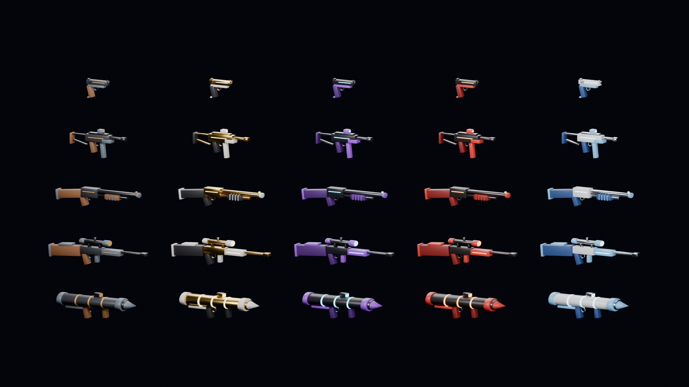

# Stylized Gun Pack

25 game-ready stylized weapons: 5 models × 5 skins, generated in Blender 5.2 from a script.



| Weapon   | Tris  | Skins |
|----------|-------|-------|
| Pistol   | 1,324 | Classic, Gilded, Neon, Inferno, Frost |
| SMG      | 1,784 | 〃 |
| Shotgun  | 1,508 | 〃 |
| Sniper   | 2,484 | 〃 |
| Launcher | 2,114 | 〃 |

## Contents

```
stylized_gun_pack.blend     editable source (all 25 assets, 25 materials)
exports/glb/                GLB: Godot, three.js, Roblox import, web viewers, Sketchfab
exports/fbx/                FBX: Unity, Unreal
exports/obj/                OBJ + MTL: anything else
renders/contact_sheet.png   store banner / gallery image
renders/thumbnails/         800×800 per-asset thumbnail
scripts/build_pack.py       generator: rebuilds everything above
```

## Technical specs

- Real-world metre scale; Z up, barrel points +X, origin at the bounding-box centre.
- One mesh per asset, quad/tri mix, angle-based smooth shading, UVs unwrapped (Smart UV).
- Materials: PBR Principled, 5 slots per asset (`body`, `accent`, `grip`, `metal`, `glow`).
  `glow` is emissive. Colours are material values, not textures, so recolouring is
  just an edit to the material.

## Rebuild or customise

```bash
pip install bpy==5.2.3            # or use your Blender install
python3 scripts/build_pack.py     # or: blender -b -P scripts/build_pack.py
```

- **New skin:** add an entry to `SKINS` and it is applied to all 5 weapons.
- **New weapon:** write a `build_xxx()` function from `box`/`cyl`/`cone`/`ring` parts
  and register it in `WEAPONS`.
- **Chunkiness:** `CHUNK` scales thickness (1.0 = realistic, 1.6 = toy style).

## Selling checklist

1. Open `stylized_gun_pack.blend`, tweak shapes and add your own details. Hand-made detail
   (decals, sculpted spikes and wings on the "legendary" skins) is what makes a pack stand out.
2. Use `renders/contact_sheet.png` as the cover and thumbnails for each item.
3. Upload `exports/` as a zip. Suggested platforms: Fab, CGTrader, itch.io, Gumroad,
   Unity Asset Store (needs a Unity package), Roblox Creator Store (import the GLB).
4. Include a license file (e.g. royalty-free for commercial games; no resale as-is).
5. Tags: `stylized`, `low poly`, `weapon`, `gun`, `skin`, `game-ready`, `fps`, `cartoon`.
